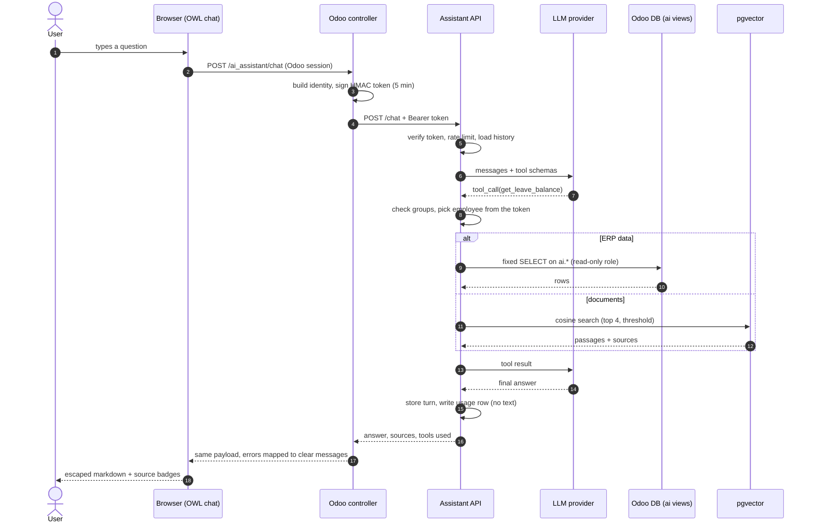

# Design notes

## Request flow

## Decisions and the alternatives that were rejected

**The model proposes, the code disposes.** The LLM chooses a tool and its arguments. Identity,
permissions, companies and SQL are decided by code. *Rejected:* letting the model write SQL
(text-to-SQL). It is more flexible, but every question becomes a potential data leak and the
answers are far harder to test.

**Odoo signs the identity; the browser never sees a secret.** The Odoo controller proxies the
request and signs `{uid, employee_id, company_ids, groups, exp}` with HMAC-SHA256. *Rejected:*
calling the API directly from the browser, which needs CORS, a public secret or a user-managed
token, and cannot express Odoo's group model.

**Groups are expanded on the Odoo side.** The token carries `all_group_ids`, including implied
groups (a sales manager implies the salesman group), so the API only has to test membership.

**Read-only views in a dedicated schema.** The `ai_readonly` role can only `SELECT` from the
`ai` views. The views are the contract: they expose the minimum columns, no payroll and no
banking data, and they insulate the API from changes in Odoo's tables. Reverting is one script.

**Agentic retrieval, not always-on retrieval.** `search_documents` is one more tool, so the model
retrieves only when the question needs documents. A cosine-score threshold makes "I found
nothing" a real outcome instead of a hallucination.

**Embeddings at 768 dimensions.** `gemini-embedding-001` returns 3072 dimensions but pgvector's
HNSW index supports at most 2000, so the API requests 768 (also compatible with OpenAI's
`dimensions` parameter). Each row stores the embedding model so vectors are never mixed.

**A provider interface with a neutral message format.** Gemini and OpenAI sit behind the same
`chat`/`embed` interface. Gemini needs the original model turn back to keep its reasoning
signatures, so the neutral message keeps an opaque `_raw` field.

**The usage log stores no text.** It records category, tools, latency, tokens and estimated cost
per request, with the user as a salted hash. That is enough to measure adoption and cost without
storing questions, which may contain personal data.

## Failure handling

| Situation | Behaviour |
|---|---|
| Missing, forged or expired token | 401 |
| No group for a tool | The tool answers `permission denied`; the model explains it |
| More than 20 requests per minute | 429 |
| Provider error or quota exhausted | 503 with a generic message; the failure is recorded |
| Daily provider quota (`PerDay`) | Not retried: waiting seconds cannot help |
| Transient 429/5xx | Retried with backoff, honouring the provider's retry hint up to 30 s |
| Empty model turn right after a tool result | One retry with an explicit instruction, then a fallback message |
| Model that keeps calling tools | Stopped after 5 iterations |
| No document above the threshold | The tool says so and instructs the model not to invent an answer |

## Known limitations

- Conversation history and rate limits live in process memory (single worker). Scaling out needs
  Redis or Postgres for both.
- The Odoo controller calls the API synchronously, so a slow model call occupies an Odoo worker.
  A queue plus polling or server-sent events would fix that.
- Documents have no per-user access control.
- The Gemini SDK is pinned to an old version; Gemini 3.x models require a newer one
  (`thought_signature` support).
- The OpenAI provider is implemented but not covered by live tests.
- Numeric answers depend on the model reading tool output correctly; the agent evaluation
  measures this rather than assuming it.
